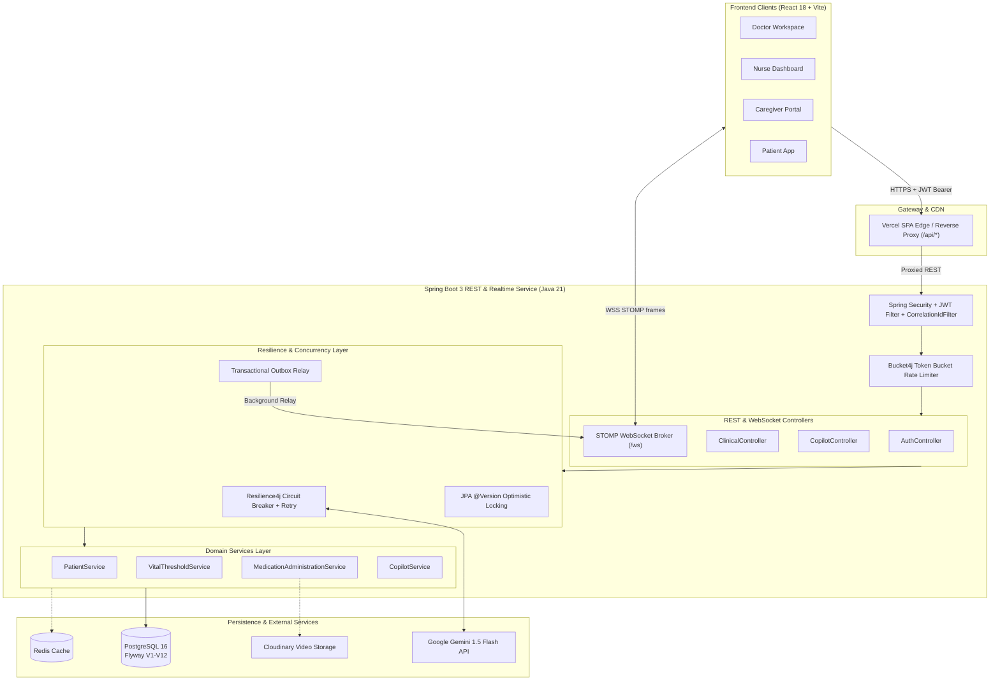
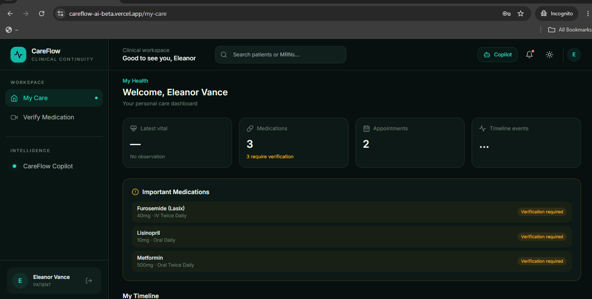

# CareFlow AI

[](https://openjdk.org/)
[](https://spring.io/projects/spring-boot)
[](https://react.dev/)
[](https://vitejs.dev/)
[](https://www.postgresql.org/)
[](https://ai.google.dev/)
[](https://www.docker.com/)
[](https://careflow-ai-beta.vercel.app/api/swagger-ui/index.html)
[](https://vercel.com/)

> **CareFlow AI** is an AI-assisted clinical coordination platform for hospitals and care teams — connecting Doctors, Nurses, Caregivers, and Patients in one unified, auditable workspace.

🏥 **[Live Demo Application](https://careflow-ai-beta.vercel.app)** — Click **"Enter Demo"** on the login page for instant role-based access.  
📖 **[Interactive Swagger API Docs](https://careflow-ai-beta.vercel.app/api/swagger-ui/index.html)** — Explore and execute REST endpoints live.

---

> [!NOTE]
> **Synthetic Demo Data Only**: CareFlow AI is an engineering portfolio demonstration with **privacy-scoped access control**. All pre-seeded clinical data, MRNs, vitals, and user accounts are synthetic. This application is not a certified healthcare record system.

---

## The Clinical & Engineering Challenge

Hospital care runs on handoffs — physician to triage nurse, day shift to night shift, hospital discharge to family caregiver. Over **80% of preventable adverse events in healthcare stem from miscommunication during care transitions**. Most hospitals rely on siloed EHR software where updates are buried in unstructured text notes, or oral phone calls that leave zero audit trail.

CareFlow solves this with a cohesive architecture:
1. **Append-Only Clinical Ledger**: Medical records are immutable by design. Rather than mutating past rows, corrections append a new record referencing `corrects_event_id`, preserving auditability.
2. **Real-time Event Stream**: STOMP-over-WebSocket pushes abnormal vitals, task assignments, and shift handoffs to role-scoped subscriber destinations in sub-second latency, patching TanStack Query caches directly without refetch storms.
3. **Resilient AI Copilot with Explainability**: Google Gemini 1.5 Flash generates clinical timeline summaries and nurse shift reports. If external AI fails, Resilience4j circuit breakers fail fast and degrade gracefully without blocking patient care. An **Explainability Panel** displays the exact historical events Gemini used for grounding.
4. **Optimistic Concurrency Control**: Double submissions or concurrent nurse administrations are guarded via `@Version` optimistic locking (Flyway V12).

---

## System Architecture



---

## Role-Based Workspaces & Screenshots

| Doctor Workspace | Nurse Shift Queue | Patient Care Dashboard |
|:---:|:---:|:---:|
|  |  |  |
| *Patient workspaces, diagnoses, prescriptions, AI summaries* | *Shift queue, vitals entry, medication administration, AI handoffs* | *Personal care dashboard, medication schedules, video verification* |

---

## One-Click Demo Accounts

All demo accounts use password **`password123`**. On the login screen, click **"Enter Demo"** to authenticate via the real JWT flow instantly.

| Role | Email | Landing Workspace | Permissions |
|:---|:---|:---|:---|
| **Doctor** | `doctor1@careflow.ai` | `/overview` | Prescribe medications, create diagnoses, set vital alert thresholds, trigger AI summaries |
| **Nurse** | `nurse1@careflow.ai` | `/nurse-dashboard` | Record vitals, administer medications, claim tasks, create AI shift handoffs |
| **Caregiver** | `caregiver@careflow.ai` | `/family` | Privacy-scoped visibility into assigned family member's timeline and care plan |
| **Patient** | `patient@careflow.ai` | `/my-care` | View personal timeline, upcoming prescriptions, and video medication verification |
| **Admin** | `admin@careflow.ai` | `/audit` | System audit logs, hospital tenant administration, staff reassignments |

---

## Quickstart (Under 4 Commands)

### Option A: Local Full Stack via Docker Compose
```bash
# 1. Clone repository
git clone https://github.com/Ashmitha148/careflow-ai.git && cd careflow-ai

# 2. Boot PostgreSQL, Spring Boot backend, and React frontend
docker-compose up --build
```
* Frontend available at: `http://localhost:3000`
* Backend REST API at: `http://localhost:8080/api`
* Swagger UI at: `http://localhost:8080/api/swagger-ui/index.html`

### Option B: Local Development
```bash
# 1. Start Backend (Uses H2 in PostgreSQL compatibility mode automatically)
cd backend && ./mvnw spring-boot:run

# 2. In a separate terminal, start Frontend
cd frontend && npm install && npm run dev
```

---

## Key Architectural Decisions

* **Why an Append-Only Timeline?** Clinical safety mandates an indelible audit trail. CareFlow models clinical events as immutable entries in `timeline_events`. Corrections append a new event referencing `corrects_event_id` rather than issuing SQL `UPDATE`s on medical history.
* **Why Transactional Outbox for AI Summaries?** Asynchronous generation of AI shift summaries should never hold open an active HTTP thread or database transaction. Mutations write an `outbox_events` record in the same atomic transaction as the clinical record, and an asynchronous relay executes retries with exponential backoff.
* **Why Client-Side TanStack Query Patching via STOMP?** Rather than using WebSockets merely as an invalidation notification that triggers refetch storms, incoming WebSocket frames carry the new entity payload and patch `queryClient.setQueryData(...)` in-memory.
* **Why Explainability for Clinical AI?** Generative outputs in clinical environments require grounding. Every prompt sent to Gemini is recorded in `ai_prompt_history` alongside the exact timeline events used in the prompt context. Clinicians can view the Explainability panel to verify evidence before signing off.
* **Why Optimistic Locking (`@Version`)?** Concurrent medication administrations by multiple care team members fail fast with HTTP 409 Conflict instead of allowing silent data overwrites.

---

## Documentation Index

* [`docs/ARCHITECTURE.md`](docs/ARCHITECTURE.md) — Comprehensive technical architecture and data flow.
* [`docs/API.md`](docs/API.md) — REST endpoint specifications, request/response models, and auth contracts.
* [`SECURITY.md`](SECURITY.md) — Privacy-scoped access control model, token rotation, rate limits, and vulnerability reporting.
* [`CONTRIBUTING.md`](CONTRIBUTING.md) — Engineering standards, commit conventions, and branch policies.
* [`CHANGELOG.md`](CHANGELOG.md) — Detailed version and migration history.
* [`INTERVIEW_NOTES.md`](INTERVIEW_NOTES.md) — 2-minute elevator pitch and 10 principal engineering interview questions with answers.
* **Architecture Decision Records (ADRs)**:
  * [ADR 0001: WebSocket Topic Design & Authorization Model](docs/adr/0001-websocket-topic-design.md)
  * [ADR 0002: Transactional Outbox & Event-Driven Backbone](docs/adr/0002-caching-and-performance-strategy.md)
  * [ADR 0003: Resilience Layer, Rate Limiting & Refresh-Token Rotation](docs/adr/0003-resilience-and-session-security.md)
  * [ADR 0004: Per-Patient Vital Alert Thresholds](docs/adr/0004-per-patient-vital-thresholds.md)
  * [ADR 0005: Multi-Hospital Tenancy Scoping](docs/adr/0005-multi-hospital-tenancy.md)
  * [ADR 0006: Hospital (Tenant) Administration](docs/adr/0006-hospital-administration.md)

---

## License

This project is licensed under the [MIT License](LICENSE) — built by [Ashmitha148](https://github.com/Ashmitha148).
