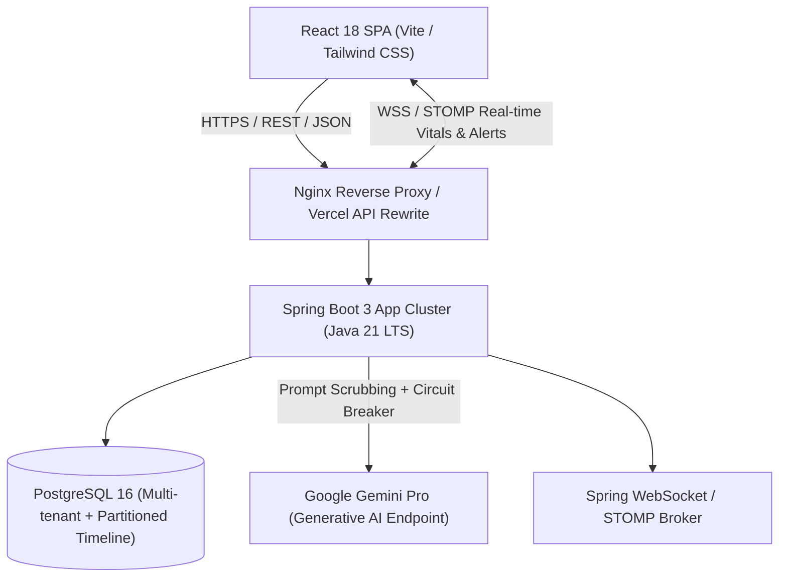

# CareFlow AI - System Architecture

CareFlow AI is an enterprise-grade clinical workflow intelligence platform built with **Spring Boot 3 (Java 21 LTS)**, **React 18 + Vite**, **PostgreSQL**, **Flyway**, and **Google Gemini AI**.

---

## 1. High-Level Architecture Diagram

---

## 2. Core Architectural Pillars

### 2.1 Multi-Tenant Privacy-Scoped Isolation
- **Tenant Scope**: Every hospital tenant (`hospital_id`) is partitioned with strict foreign keys and method-level access controls (`@PreAuthorize`).
- **Data Protection**: Patient records are accessible solely through assigned clinician linkages and privacy-scoped authorization boundaries.
- **Synthetic Data Guarantee**: All sample personas, timelines, and vitals are synthetically generated for demonstration and evaluation purposes.

### 2.2 Resilient Clinical AI Integration
- **Zero-Block Guarantees**: AI features (Copilot, Shift-Handoff summaries, Timeline synthesizers) run asynchronously with Resilience4j circuit breakers, timeouts, and fallbacks. Clinical workflows are never blocked when external AI services experience latency or degradation.
- **PII Scrubbing**: Patient identifiers, dates of birth, and clinician names are removed or tokenized prior to prompt transmission to Gemini endpoints.
- **Explainability & Grounding**: Every generated insight records the specific timeline events and prompt history used for inference in `ai_prompt_history`.

### 2.3 Optimistic Concurrency & Auditability
- **Optimistic Locking**: Critical entities (`Patient`, `Task`, `MedicationAdministration`) utilize `@Version` concurrency checks to prevent conflicting submissions.
- **Append-Only Timeline**: Clinical observations and events are stored immutably to preserve longitudinal integrity.
- **Transactional Outbox**: Events emitted to WebSocket topics are recorded transactionally to ensure at-least-once delivery.

---

## 3. Technology Stack Reference

| Component | Technology | Rationale |
|---|---|---|
| **Backend Runtime** | Java 21 LTS / Spring Boot 3.4+ | Virtual threads, record types, strong type safety, and modern standard library. |
| **Persistence** | PostgreSQL 16 + Flyway | Version-controlled schema migrations, ACID transactional integrity, composite B-tree indexing. |
| **Security** | Spring Security 6 + JWT + HttpOnly Cookies | Stateless bearer token verification, cross-domain cookie rotation, role-based access control. |
| **Resilience & Rate Limiting** | Resilience4j + Bucket4j | Token-bucket rate limiting on auth/AI routes, circuit breakers, and exponential backoff retries. |
| **Frontend Runtime** | React 18, Vite, TanStack Query | Declarative state synchronization, automated caching/revalidation, and high-performance bundle sizes. |
| **Documentation & Quality** | SpringDoc OpenAPI 3, Vitest, JaCoCo | Interactive API contract validation, high-coverage automated unit/integration testing suites. |
