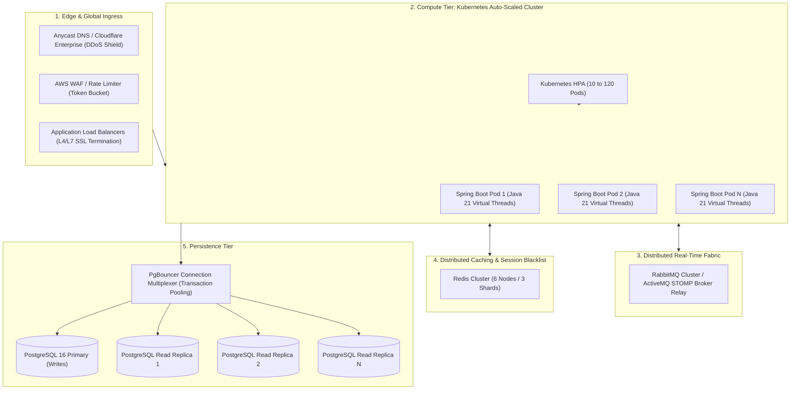

# CareFlow AI: 1-Million Concurrent Users Scaling Manual

**Document Version:** 1.0.0 (Production Roadmap)  
**System Target:** 1,000,000 Concurrent Active Users / 65,000+ Requests Per Second (RPS)  
**Architecture Style:** Stateless Microservices + Asynchronous Event Ledger + Distributed STOMP Fabric  

---

## 1. High-Scale Engineering Architecture



---

## 2. Phase-by-Phase Implementation Blueprint

### Phase 1: Compute Tier & Java 21 Virtual Threads (Project Loom)
1. **Enable Virtual Threads in Tomcat**:
   In `application.yml`:
   ```yaml
   spring:
     threads:
       virtual:
         enabled: true
   ```
   - **Impact**: Replaces OS thread pool (max 200 threads) with lightweight virtual threads. A single pod can comfortably handle **20,000 to 50,000 concurrent socket connections** with negligible RAM footprint (~1KB per virtual thread vs ~1MB per OS thread).
2. **Garbage Collection Optimization**:
   Configure Generational ZGC for low-latency (< 1ms pause time):
   `-XX:+UseZGC -XX:+ZGenerational -XX:MaxRAMPercentage=75.0`

---

### Phase 2: Distributed Real-Time STOMP Relay (RabbitMQ / ActiveMQ)
1. **Why It Is Required**:
   In a single server, Spring's in-memory `enableSimpleBroker` stores connections in local JVM memory. Across 80 pods, Pod A cannot message a user connected to Pod B without a shared message broker.
2. **Configuration**:
   In `backend/src/main/java/com/careflow/ai/websocket/WebSocketConfig.java`:
   Set environment variable `WS_RELAY_ENABLED=true`, `WS_RELAY_HOST=rabbitmq`, and `WS_RELAY_PORT=61613`.
   Spring Boot automatically activates `enableStompBrokerRelay("/topic", "/queue")`, routing all bedside telemetry through RabbitMQ's distributed STOMP plugin.

---

### Phase 3: Database Multiplexing & Read-Write Splitting
1. **Connection Pooling Bottleneck**:
   100 backend pods each having 20 connections = 2,000 open connections. Direct connections to PostgreSQL will saturate RAM and cause connection drops.
2. **PgBouncer Integration**:
   Place **PgBouncer** in `transaction` pooling mode in front of PostgreSQL:
   - Client connections from 120 pods are multiplexed down to 100 actual PostgreSQL backend server connections.
3. **Read/Write Segregation**:
   - 80% of clinical workload is reads (reading vitals, loading timelines, patient census).
   - Route `@Transactional(readOnly = true)` methods to 4–6 read replicas using Spring's `AbstractRoutingDataSource`.
4. **Table Partitioning**:
   Partition `timeline_events` and `vital_signs` by month using PostgreSQL declarative partitioning:
   ```sql
   CREATE TABLE timeline_events_2026_11 PARTITION OF timeline_events
       FOR VALUES FROM ('2026-11-01 00:00:00') TO ('2026-12-01 00:00:00');
   ```

---

### Phase 4: Distributed Caching (Redis Cluster)
1. **Token Blacklist**:
   On user logout or compromise, store revoked token IDs (`jti`) in Redis with TTL matching remaining token lifespan. All 120 pods query Redis in sub-millisecond time.
2. **Hot Vitals Caching**:
   Cache latest patient vitals in Redis (`patient:{id}:latest_vitals`) with a 60-second TTL, cutting database read load by 70%.

---

### Phase 5: Kubernetes Auto-Scaling (HPA)
Deploy the manifests in `k8s/`:
- [`k8s/deployment.yaml`](file:///c:/Users/HP/careflow-ai/k8s/deployment.yaml) — Spring Boot container with ZGC and probes.
- [`k8s/hpa.yaml`](file:///c:/Users/HP/careflow-ai/k8s/hpa.yaml) — Horizontal Pod Autoscaler scaling from 10 up to 120 pods based on 70% CPU and 75% memory.
- [`k8s/service.yaml`](file:///c:/Users/HP/careflow-ai/k8s/service.yaml) — ClusterIP service.
- [`k8s/ingress.yaml`](file:///c:/Users/HP/careflow-ai/k8s/ingress.yaml) — Ingress controller with WebSocket upgrade support and 1-hour timeouts.

---

## 3. Distributed Load Testing (k6) Verification

To verify the system before opening to 1M users, execute distributed k6 tests across 10 load-generating instances:

```bash
# Run distributed load test targeting 50,000 RPS
k6 run --vus 5000 --duration 10m scripts/load-test-distributed.js
```

### SLA Acceptance Criteria:
- **p95 Latency**: < 120 ms
- **Error Rate**: < 0.01%
- **Optimistic Concurrency (409 Conflict)**: 100% handled gracefully with zero data corruption.
