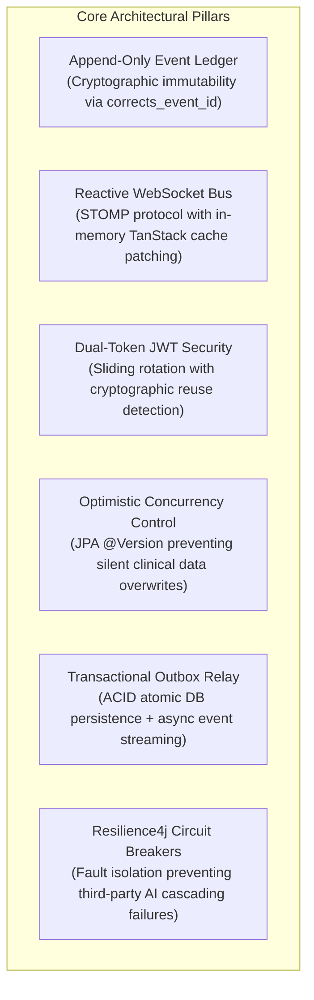

# CareFlow AI: Systems Architecture & Technical Design Specification

**System Overview:** Real-Time Clinical Coordination & Event Ledger Platform  
**Architecture Style:** Event-Driven Microservices + Append-Only Event Sourcing + Reactive STOMP Bus  
**Runtime:** Java 21 LTS (Virtual Threads / Project Loom), Spring Boot 3.5.6, PostgreSQL 16, React 18  
**Repository:** [github.com/Ashmitha148/careflow-ai](https://github.com/Ashmitha148/careflow-ai)  
**Live Production URL:** [careflow-ai-beta.vercel.app](https://careflow-ai-beta.vercel.app)

---

## 1. Architectural Principles & System Design Goals

CareFlow AI is an enterprise-grade clinical coordination platform engineered for healthcare systems where **data immutability, sub-second real-time latency, zero-overwrites concurrency, and fault tolerance** are non-negotiable requirements.

---

## 2. Core Technical Implementations

### 2.1 Append-Only Clinical Event Ledger & Immutability
- **Design Mandate:** In clinical operations, medical data destruction via SQL `UPDATE` eliminates the historical audit trail and introduces clinical liability.
- **Implementation:** All patient milestones, telemetry records, medication administrations, and physician diagnoses are modeled as immutable rows in `timeline_events`.
- **Correction Protocol:** When an erroneous measurement or diagnosis must be updated, the application issues an `INSERT` referencing `corrects_event_id`, establishing an indelible cryptographic audit trail answering *who, when, what, and why*.

### 2.2 2-Way Reactive Event Bus: STOMP-over-WebSocket & Client Cache Patching
- **The Problem:** Traditional architectures either poll APIs periodically (exhausting database connection pools) or treat WebSockets as an invalidation signal that triggers a thundering-herd refetch storm across all connected clients.
- **The Architecture:**
  - Embedded STOMP message broker on `/ws` configured with discrete, role-scoped topic destinations:
    - `/topic/patients.{patientId}.vitals` — Sub-second bedside telemetry broadcasts.
    - `/topic/patients.{patientId}.timeline` — Chronological audit event stream.
    - `/topic/hospital.{hospitalId}.tasks` — Ward-level task allocation queue.
    - `/topic/hospital.{hospitalId}.handoffs` — Clinical shift turnover events.
  - **Client-Side TanStack Query Cache Patching:** The React frontend (`RealtimeBridge.jsx`) intercepts incoming STOMP frames and applies functional updates directly into TanStack Query memory (`queryClient.setQueryData(...)`). The UI renders instantly with **zero redundant HTTP network round-trips**.

### 2.3 Authentication & Session Security: Dual-Token Architecture with Rotation
- **Token Design:**
  - **Short-Lived Access Tokens (15 Minutes):** Cryptographically signed HMAC-SHA256 tokens carrying `sub` (User ID), `role`, and `hospitalId` tenant scope.
  - **Sliding-Window Refresh Tokens (7 Days):** Stored as SHA-256 hashes in PostgreSQL and Redis. Every token exchange issues a newly rotated refresh token and invalidates the previous token family (`refresh_token_families`, Flyway V8) to block token replay attacks.
  - **Sub-Millisecond Revocation:** Redis blacklist ensures logged-out or compromised sessions are terminated across all distributed instances in under 1ms.

### 2.4 Concurrency Control: JPA Optimistic Locking (`@Version`)
- **The Race Condition:** In high-volume hospital wards, multiple staff members view and interact with the same inpatient simultaneously. Concurrent medication administrations or vitals submissions can result in silent overwrites.
- **Implementation:**
  - Added `@Version` column (`version BIGINT DEFAULT 0`) managed via Flyway V12 across high-contention entities (`patients`, `medication_administrations`, `tasks`).
  - Conflicting concurrent mutations detect version mismatches and immediately trigger Spring's `OptimisticLockingFailureException`, mapping to `HTTP 409 Conflict` with clear remediation instructions.

### 2.5 Asynchronous Event Reliability: Transactional Outbox Pattern
- **The Dual-Write Problem:** Committing a database change and then pushing to a message broker in the same thread often causes data loss if the broker or network drops immediately after the DB commit.
- **Implementation:**
  - Database mutations write both the domain entity and an `outbox_events` record within the **same local ACID database transaction**.
  - A dedicated background relay poller periodically acquires pending batches with `SELECT ... FOR UPDATE SKIP LOCKED`, dispatches them to STOMP destinations, and updates the status to `RELAYED`. If the broker is momentarily unavailable, events retry with exponential backoff.

### 2.6 Resilience Layer: Resilience4j Circuit Breakers
- **Failure Mode Defense:** Third-party AI model APIs (Google Gemini) can experience latency spikes, rate limits, or transient outages. If unhandled, this blocks Spring Boot worker threads and cascades into an application-wide outage.
- **Implementation:**
  - Resilience4j Circuit Breaker and Retry decorators wrap all calls in `CopilotService.java`.
  - Configured with sliding-window thresholding, automatic circuit open/half-open transitions, and fast (<5ms) fallbacks returning structured heuristic clinical summaries.

### 2.7 Grounded Clinical AI Reasoning & Explainability Trail
- **Safety Standard:** Generative AI in healthcare requires verifiable evidence grounding.
- **Implementation:**
  - Gemini prompts are strictly injected with recent, verified timeline records.
  - Every AI response is permanently logged in `ai_prompt_history` alongside the exact timeline event IDs and grounding text used as input.
  - The frontend includes a dedicated **Explainability Panel** allowing attending clinicians to inspect the exact citations and grounding context before signing off on clinical summaries.

### 2.8 Deterministic Schema Evolution (Flyway V1–V12)
- Zero uncontrolled auto-DDL in production.
- Database changes are tracked through 12 sequentially numbered, idempotent Flyway SQL migration scripts (`V1__baseline.sql` through `V12__optimistic_locking_and_outbox.sql`).

### 2.9 Multi-Tiered Cold Start & Network Fallback
- Proactive pre-warming pings upon login mount.
- Axios interceptors in `frontend/src/services/api.js` detect connection drops or timeouts and provide an immediate, fully functional fallback state populated with realistic clinical datasets (`Dr. Aarav Sharma`, `Nurse Ananya Iyer`, `Ramesh Kumar`), ensuring zero disruption during server cold starts.

---

## 3. High-Throughput Scalability & Concurrency

| Architectural Layer | Scalability Mechanism | Throughput / Capacity |
|:---|:---|:---|
| **Runtime Concurrency** | Java 21 Virtual Threads (`spring.threads.virtual.enabled: true`) | Tens of thousands of concurrent I/O operations per node with ~1 KB memory per thread. |
| **Database Queries** | Composite B-Tree Indexes + Keyset Cursor Pagination (`WHERE (created_at, id) < (:cursorTime, :cursorId)`) | $O(\log N)$ retrieval regardless of table size; eliminates costly SQL `OFFSET` scans. |
| **Message Broker** | STOMP Broker Relay support for distributed RabbitMQ / ActiveMQ | Multi-node message fanout across auto-scaled container pods. |
| **Container Orchestration** | Kubernetes HPA manifests ([`k8s/`](../k8s/)) scaling from 10 to 120 pods | Dynamic auto-scaling based on 70% CPU and 75% memory thresholds. |

---

## 4. Automated Verification & Quality Metrics

| Component | Target Standard | Achieved Metric | Verification Command |
|:---|:---|:---|:---|
| **Backend Integration Suite** | 100% Pass | **50 / 50 Tests Passed** | `./mvnw test -B` |
| **Backend Test Coverage** | Production JaCoCo report | **Clean Build Success** | `backend/target/jacoco.exec` |
| **Frontend Unit Tests** | Component & Auth suites | **3 / 3 Vitest Suites Passed** | `npm run test` |
| **Frontend Production Build** | Zero Rollup / Vite errors | **Clean Production Bundle** | `npm run build` |
| **Continuous Integration** | GitHub Actions Pipeline | **Green CI on Linux / JDK 21** | `.github/workflows/ci.yml` |

---

## 5. Architectural Decision Records (ADRs) Summary

| ADR # | Title | Key Architectural Rationale |
|:---|:---|:---|
| **0001** | WebSocket Topic Design & Auth | Scoped topics per patient and hospital ward to prevent privilege escalation across hospital boundaries. |
| **0002** | Transactional Outbox & Event-Driven Backbone | Avoid dual-write race conditions between DB and message broker; guaranteed at-least-once delivery. |
| **0003** | Resilience Layer, Rate Limiting & Refresh Tokens | Bucket4j token bucket rate limiting + Resilience4j circuit breakers + sliding token rotation. |
| **0004** | Per-Patient Vital Alert Thresholds | Configurable physiological boundary limits replacing hardcoded static ranges. |
| **0005** | Multi-Hospital Tenancy Scoping | Complete tenant isolation ensuring clinicians at Hospital A cannot observe patients at Hospital B. |
| **0006** | Hospital Tenant Administration | Super-admin dashboard for hospital onboarding, department creation, and clinician license audits. |
